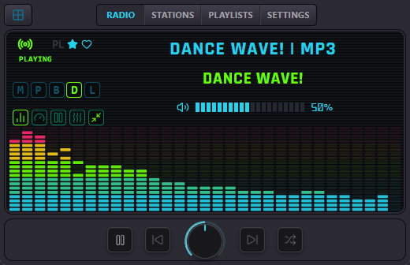

# AmpPulse

**Ampulsive by nature.**  
*A modern, ultra-lightweight desktop audio & internet radio player built with Rust & Tauri.*

  
  
  
  

  <a href="https://amppulse.netlify.app/"><strong>🌐 Official Website</strong></a>
  &nbsp;&bull;&nbsp;
  <a href="https://github.com/AmpPulseApp/amppulse/releases/latest"><strong>⬇️ Download Latest</strong></a>
  &nbsp;&bull;&nbsp;
  <a href="https://github.com/AmpPulseApp/amppulse/issues"><strong>🐛 Report a Bug</strong></a>

 

---

### Why AmpPulse?

* **The Sweet Spot:** Built to replace crashing legacy players like RadioSure—and modern alternatives that are either too barebones or overly cluttered. Classic Winamp speed on a clean **Rust + Tauri** core.
* **Tiny Footprint:** ~4 MB installer, ~3.5 MB Rust core RAM, and `< 0.5%` CPU in compact mode.
* **Zero Telemetry & No Accounts:** No analytics, no tracking, no login, and no newsletter signups. Your favorites and playlists stay locally on your machine.
* **Freemium Done Fairly:** Free **Lite** version with zero ads, or an optional one-time **Pro** purchase for v1.x—never a subscription.

> **Note:** AmpPulse is closed-source software. Official downloads, changelogs, and issue tracking live in the [`amppulse`](https://github.com/AmpPulseApp/amppulse) repository.
